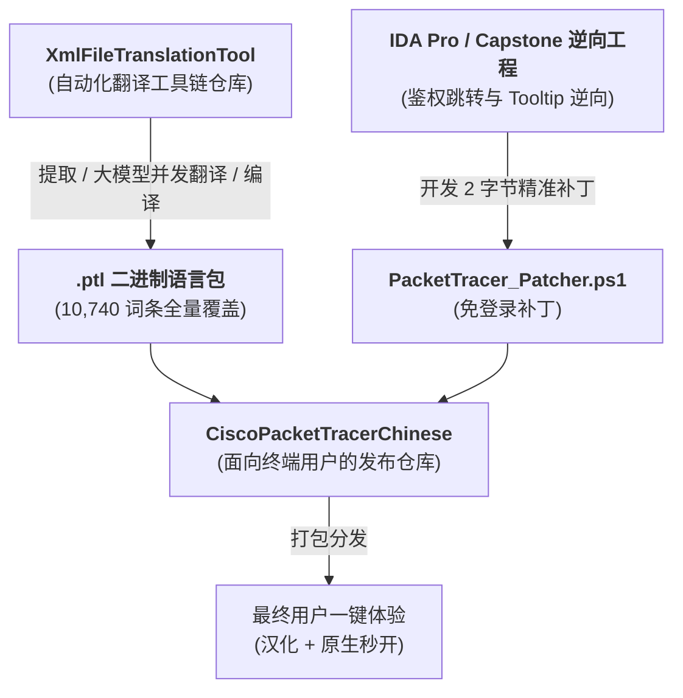

# 🔬 Cisco Packet Tracer 汉化与免登录补丁底层技术白皮书 (Technical Architecture & Reverse Engineering)

> 本文档面向广大极客、网络工程爱好者以及开源维护者，深入揭秘 **Cisco Packet Tracer (CPT)** 的汉化技术架构、Qt 界面国际化底层实现机理，以及 9.0.1 原生免登录二进制补丁的逆向细节。

---

## 目录
1. [项目架构与工程分工](#1-项目架构与工程分工)
2. [Qt Linguist 语言包编译机制](#2-qt-linguist-语言包编译机制)
3. [核心疑难剖析：为什么分类能汉化，而鼠标悬停提示是英文？](#3-核心疑难剖析为什么分类能汉化而鼠标悬停提示是英文)
4. [9.0.1 原生免登录补丁（Patcher）深度逆向](#4-901-原生免登录补丁patcher深度逆向)
5. [跨分区全自动安装脚本技术规范](#5-跨分区全自动安装脚本技术规范)
6. [后续版本持续升级指南](#6-后续版本持续升级指南)

---

## 1. 项目架构与工程分工

整个汉化与工具体系由两个协同开源仓库组成：



- **[XmlFileTranslationTool](https://github.com/Liu8Can/XmlFileTranslationTool)**：负责数据清洗、跨版本缓存比对、调用大语言模型 API 增量翻译并编译 `.ptl`。
- **[CiscoPacketTracerChinese](https://github.com/Liu8Can/CiscoPacketTracerChinese)**：面向普通用户的最终发布仓库，提供开箱即用的 `.ptl` 文件、批处理一键安装包及免登录工具。

---

## 2. Qt Linguist 语言包编译机制

Cisco Packet Tracer 采用 **Qt 6 C++ 框架** 构建界面。其官方国际化流程为：
1. 开发者在 C++ 源码中使用 `tr("Hello")` 或 `QCoreApplication::translate("Context", "Hello")` 标记待翻译文本。
2. 通过 Qt 的 `lupdate` 工具提取生成 XML 格式的 `.ts` 翻译源文件（如 `template.ts`）。
3. 翻译完成后，使用 `lrelease` 将 `.ts` 编译为紧凑高效的二进制哈希索引文件（`.qm`，思科重命名为 `.ptl`）。
4. 软件启动时加载 `.ptl`，并在调用 `tr()` 时动态查询并显示目标语言文本。

本套件的 `哔哩哔哩 沧浪同学 中文汉化包.ptl` 涵盖了 **10,740 条完整翻译**（0 条未完成），实现了主菜单、拓扑画布、设备物理视图、配置界面、CLI 仿真控制台、IoT 智能家居等核心功能的深度汉化。

---

## 3. 核心疑难剖析：为什么分类能汉化，而鼠标悬停提示是英文？

### 3.1 现象描述
在 Packet Tracer 主界面左下角设备盒：
- 点击设备分类图标，下方文本框显示完整的中文：`[网络设备]`、`[终端设备]`、`[智能家居]`、`[智慧城市]`。
- 但当鼠标悬停在图标上方时，弹出的 Tooltip 悬浮提示框显示的却是英文快捷键组合（如 `Smart City Ctrl+Alt+T`、`Home Ctrl+Alt+H`）。

### 3.2 底层反汇编实证
为了探究根本原因，我们使用反汇编工具对 `PacketTracer.exe` 进行了数据流追踪：

1. **设置悬停提示的汇编代码**（位于 `CDeviceTypesBox` 模块，函数地址 `0x1424e64e0`）：
   ```x86asm
   0x1424e8596: lea  rcx, [rbx + 0xb0]    ; 读取快捷键字符串 (例如 "Ctrl+Alt+T")
   0x1424e859d: call QString::isEmpty()   ; 检查快捷键是否为空
   0x1424e85ab: mov  rdx, rbx             ; rbx 为设备分类名原始字符串 ("Smart City")
   0x1424e85ae: lea  rcx, [rsp + 0x60]    ; 创建临时 QString 变量 tooltip
   0x1424e85b3: call QString::QString(QString const&) ; tooltip = rbx
   0x1424e85c4: lea  rcx, " "             ; 加载空格字符
   0x1424e85f3: call QString::append(const char*)     ; tooltip.append(" ")
   0x1424e85f9: lea  rdx, [rbx + 0xb0]    ; 加载快捷键
   0x1424e8605: call QString::append(QString const&) ; tooltip.append(shortcut)
   0x1424e865c: call QWidget::setToolTip(QString)     ; 💥 关键点：直接将未翻译字符串传给 setToolTip！
   ```

2. **为什么语言包无法汉化它？**
   在上述汇编代码中可以看到，思科程序员构造 `tooltip` 时直接拼接了内存中的原始分类名 `typeName` 与快捷键，然后**直接调用了 `QWidget::setToolTip`，完全没有包裹 `tr()` 或 `QCoreApplication::translate()`**！
   Qt 的国际化引擎（`QTranslator`）只会在程序显式调用 `tr()` 时介入。如果 C++ 源码压根没有写 `tr()`，语言包即使包含了对应翻译也绝对无法被调用。

3. **能否在二进制文件中直接将 `.rdata` 里的 `"Smart City"` 字符串改为 `"智慧城市"`？**
   **绝对不能！**
   我们通过交叉引用分析发现，可执行文件偏移 `0x2c6abc0` 处的 `"Smart City"` 字符串不仅用于 UI 显示，还同时充当了**底层核心哈希表（`m_vDTValues`）的检索键（Key）**：
   - 软件在启动加载 `DeviceTypesConfig.json` 配置文件时，正是用 `"Smart City"` 查找对应的设备列表。
   - 如果在二进制中强行改写该字符串，会导致键值无法匹配，软件会在控制台抛出警告：
     ```text
     Device group 'Smart City' has no matching device types in m_vDTValues, skipping
     ```
     **直接导致该分类下的所有子设备图标（路灯、传感器、汽车等）彻底消失！**

### 3.3 结论与最佳工程决策
- **这是官方源码级代码硬编码遗漏**，属于国际化设计瑕疵。
- **最佳实践**：作为正规无损语言包，应当**保持现状**。不建议为了几个悬浮词条而采用注入外挂 DLL 或挂钩内存代码的高风险方案。

---

## 4. 9.0.1 原生免登录补丁（Patcher）深度逆向

### 4.1 传统防火墙方案在 9.0.1 失效的原因
在 8.x 及更早版本中，用户只需利用防火墙阻止 `PacketTracer.exe` 联网，软件检测不到网络就会自动降级为离线模式，允许直接使用。
但在 **9.0.1** 中，思科引入了更严格的前置网络认证逻辑：当检测到网络被直接切断时，主进程会弹出网络故障阻塞窗口，强制要求重新连接或登录，导致原有的 `BanNetwork.bat` 防火墙方案彻底失效。

### 4.2 9.0.1 二进制精准 Patch 机理
通过逆向跟踪主工作区初始化代码流，我们定位到了决定是否弹出 Cisco 登录认证窗口的核心跳转逻辑：

- **目标二进制文件**：`bin\PacketTracer.exe`
- **文件物理偏移**：`0x24a1068`
- **原版二进制与汇编**：
  ```x86asm
  文件偏移 0x24a1068:
  0F 85 B0 0C 00 00    jne 0x1424a1d1e   ; 若未通过登录校验，则跳转到登录弹窗逻辑
  ```
- **Patch 后二进制与汇编**：
  ```x86asm
  文件偏移 0x24a1068:
  E9 B1 0C 00 00 90    jmp 0x1424a1d1e; nop ; 无条件直接跳过登录验证，直入拓扑工作区
  ```

### 4.3 补丁方案优势
1. **极致轻量**：仅修改 **2 字节**指令操作码（`0F 85` $\rightarrow$ `E9` + `90`），不改动任何其他代码或资源区段。
2. **零驻留、零误报**：不注入任何外部 DLL，无任何后台守护进程，软件启动速度达到官方原版毫秒级响应。
3. **安全可逆**：补丁工具在修补前会自动对官方原版备份为 `PacketTracer.exe.bak`，支持一键无损秒级还原。

---

## 5. 跨分区全自动安装脚本技术规范

为了让普通用户无需手动翻找系统文件夹，本仓库提供了 `一键安装汉化包.bat` 与 `PacketTracer9.0.1_一键补丁工具.bat`：

### 5.1 编码标准：ANSI (CP936) 铁律
Windows 中文系统的命令提示符（`cmd.exe`）默认编码为 `CP936`。若批处理脚本以 UTF-8 编码保存，执行包含中文字符的 `echo` 或 `pause` 时，必定出现乱码甚至指令被多字节截断闪退。
**本项目的所有 `.bat` 脚本均严格采用 ANSI (GBK/CP936) 编码格式存储。**

### 5.2 跨逻辑驱动器动态枚举
脚本通过 PowerShell 调用 WMI/CIM 接口动态探测本机所有固定物理驱动器（`DriveType=3`），自动匹配如下候选路径：
- `C:\Program Files\Cisco Packet Tracer 9.0.1`
- `D:\Program Files\Cisco Packet Tracer 9.0.1`
- `E:\Program Files\Cisco Packet Tracer 9.0.1`
- `F:\Program Files\Cisco Packet Tracer 9.0.1`
彻底解决了安装在非系统盘的用户无法使用一键安装工具的问题。

---

## 6. 后续版本持续升级指南

当思科未来发布 9.0.2、9.1 等新版本时，升级维护标准化流程如下：
1. 从新版安装目录的 `languages/` 中提取官方最新的 `template.ts`。
2. 将当前版本的 `translation_cache.json` 复制到新版本目录。
3. 在 [XmlFileTranslationTool](https://github.com/Liu8Can/XmlFileTranslationTool) 中执行增量翻译命令。
4. 工具将自动命中 98%+ 的历史已校对缓存，仅对新增词条请求大模型补充，生成新版 `.ptl`。
5. 针对新版 `PacketTracer.exe` 搜索跳转特征码，更新 `PacketTracer_Patcher.ps1` 中的偏移量，即可完成全套适配发布。
